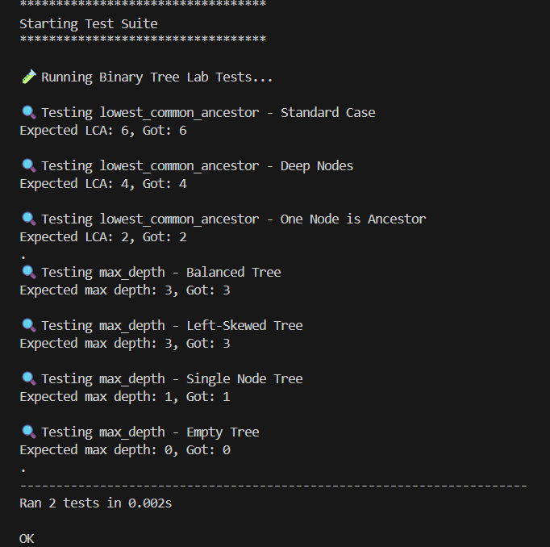

# Lab: Binary Trees – Depth and Ancestors

## Overview

This project implements two fundamental binary tree algorithms using Python and recursion:

1. **Maximum Depth of a Binary Tree** – Calculates the longest path from the root node to a leaf node
2. **Lowest Common Ancestor of a Binary Search Tree** – Identifies the deepest shared ancestor of two nodes in a Binary Search Tree (BST)

The lab focuses on recursive tree traversal, binary search tree properties, and efficient algorithm design.

## Learning Objectives

- Understand the structure and properties of binary trees
- Implement recursive algorithms for tree traversal
- Calculate the maximum depth of a binary tree
- Find the lowest common ancestor of two nodes in a BST
- Analyze time and space complexity using Big O notation
- Validate implementations using Python's `unittest` framework

## Project Structure

```text
binary-tree-lab/
├── binary_tree_lab.py
├── binary_tree_tests.py
├── README.md
└── screenshots/
    └── test_suite.png
```

### File Descriptions

- `binary_tree_lab.py` – Contains the TreeNode class and both recursive algorithms
- `binary_tree_tests.py` – Contains unit tests for maximum depth and lowest common ancestor
- `README.md` – Project documentation, setup instructions, and algorithm explanations
- `screenshots/` – Contains screenshots demonstrating successful test execution

## Technologies Used

- Python 3
- Python `typing` module
- Python `unittest` framework
- Git and GitHub

## Getting Started

### 1. Clone the Repository

```bash
git clone https://github.com/Matt20Swanberg/binary-tree-lab
cd binary-tree-lab
```

### 2. Verify Python Installation

Ensure Python 3 is installed:

```bash
python --version
```

### 3. Run the Test Suite

Execute the provided tests:

```bash
python binary_tree_tests.py
```

No third-party dependencies are required.

## Implementation Details

### 1. TreeNode Class

The `TreeNode` class represents an individual node within a binary tree.

Each node contains:

- `val` – Integer value stored in the node
- `left` – Reference to the left child node
- `right` – Reference to the right child node

```python
class TreeNode:
    def __init__(self, val: int):
        self.val = val
        self.left: Optional['TreeNode'] = None
        self.right: Optional['TreeNode'] = None
```

The left and right child references are initialized to `None`.

### 2. Maximum Depth of a Binary Tree

**Function:** `max_depth(root)`

Calculates the maximum depth of a binary tree by determining the longest path from the root to a leaf node.

#### Algorithm

1. Check whether the current node is `None`
2. Return `0` if the tree is empty
3. Recursively calculate the depth of the left subtree
4. Recursively calculate the depth of the right subtree
5. Return the greater depth plus `1` for the current node

#### Implementation

```python
def max_depth(root: Optional[TreeNode]) -> int:
    if root is None:
        return 0

    left_depth = max_depth(root.left)
    right_depth = max_depth(root.right)

    return max(left_depth, right_depth) + 1
```

#### Example

```text
       3
      / \
     9   20
        /  \
       15   7
```

The longest path contains three nodes:

```text
3 → 20 → 15
```

**Expected Output:**

```python
3
```

### 3. Lowest Common Ancestor of a Binary Search Tree

**Function:** `lowest_common_ancestor(root, p, q)`

Finds the deepest node that is an ancestor of both target nodes in a Binary Search Tree.

A node may also be considered an ancestor of itself.

#### Binary Search Tree Properties

A Binary Search Tree follows these rules:

- Values in the left subtree are smaller than the current node
- Values in the right subtree are greater than the current node

These properties allow the algorithm to search only one subtree at a time.

#### Algorithm

1. Compare the target node values against the current node
2. If both target values are smaller, recursively search the left subtree
3. If both target values are greater, recursively search the right subtree
4. Otherwise, return the current node as the lowest common ancestor

The implementation assumes both target nodes exist in the BST and node values are unique.

#### Implementation

```python
def lowest_common_ancestor(
    root: TreeNode, p: TreeNode, q: TreeNode
) -> TreeNode:

    if root.val > p.val and root.val > q.val:
        return lowest_common_ancestor(root.left, p, q)

    elif root.val < p.val and root.val < q.val:
        return lowest_common_ancestor(root.right, p, q)

    return root
```

#### Example

```text
        6
       / \
      2   8
     / \ / \
    0  4 7  9
      / \
     3   5
```

Given:

```python
p = 3
q = 5
```

Both nodes share node `4` as their lowest common ancestor.

**Expected Output:**

```python
4
```

## Testing

The project uses Python's built-in `unittest` framework.

The test suite validates both recursive algorithms across seven scenarios organized into two test methods.

### Maximum Depth Tests

| Test Case | Expected Result |
|---|---|
| Balanced binary tree | 3 |
| Left-skewed binary tree | 3 |
| Single-node tree | 1 |
| Empty tree | 0 |

### Lowest Common Ancestor Tests

| Test Case | Expected Result |
|---|---|
| Standard case: nodes 2 and 8 | 6 |
| Deep nodes: nodes 3 and 5 | 4 |
| One node is an ancestor: nodes 2 and 4 | 2 |

### Running All Tests

```bash
python binary_tree_tests.py
```

### Running Individual Test Methods

Test maximum depth:

```bash
python -m unittest binary_tree_tests.TestBinaryTreeFunctions.test_max_depth -v
```

Test lowest common ancestor:

```bash
python -m unittest binary_tree_tests.TestBinaryTreeFunctions.test_lowest_common_ancestor -v
```

### Test Results

Both test methods pass successfully, covering all seven scenarios.

```text
Ran 2 tests in ...s

OK
```

## Screenshots

### Successful Test Suite

The following screenshot demonstrates successful execution of the provided unit tests.



## Time and Space Complexity

Big O notation describes how an algorithm's execution time and memory requirements scale with input size.

### Maximum Depth

**Time Complexity: O(n)**

- Every node in the binary tree is visited once
- The algorithm calculates the depth of both subtrees recursively
- Execution time increases linearly with the number of nodes

**Space Complexity: O(h)**

- Recursive calls use memory on the call stack
- The maximum recursion depth depends on the height of the tree
- A balanced tree requires O(log n) stack space
- A skewed tree requires O(n) stack space

### Lowest Common Ancestor

**Time Complexity: O(h)**

- The algorithm follows one path through the BST
- It does not need to visit every node
- A balanced BST requires O(log n) time
- A skewed BST may require O(n) time

**Space Complexity: O(h)**

- Recursive calls use memory on the call stack
- A balanced BST requires O(log n) stack space
- A skewed BST may require O(n) stack space

### Complexity Summary

| Algorithm | Time Complexity | Space Complexity |
|---|---|---|
| Maximum Depth | O(n) | O(h) |
| Lowest Common Ancestor | O(h) | O(h) |

Where:

- `n` represents the total number of nodes
- `h` represents the height of the tree

## Key Takeaways

- Recursion provides a straightforward approach to traversing binary trees
- Base cases prevent recursive functions from running indefinitely
- Maximum depth requires evaluating both subtrees
- Binary Search Tree properties allow more efficient navigation
- The lowest common ancestor is identified when target nodes diverge or the current node matches a target
- Tree balance significantly affects recursive time and space complexity

## Author

Created by Matthew Swanberg as part of Course 10 Module 7 (Lab: Binary Trees– Depth and Ancestors)